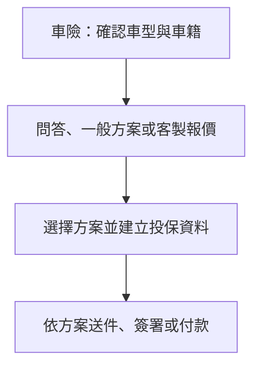
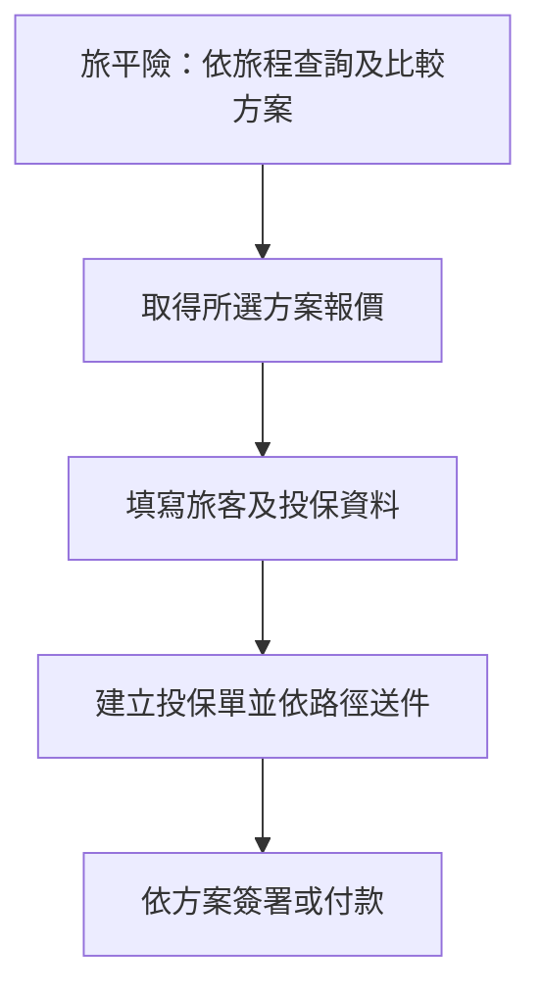
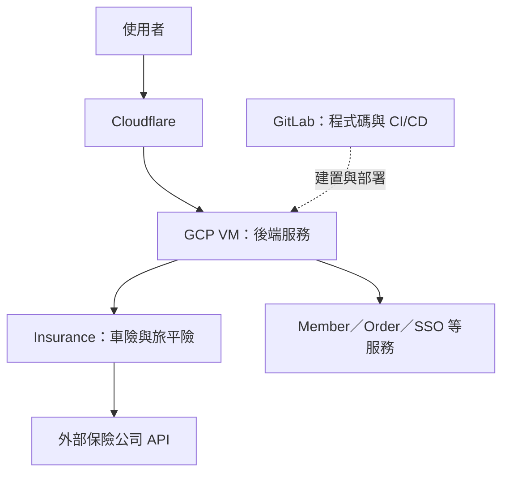

# 產險投保平台｜車險與旅平險

整合多家保險公司的商品與投保作業，支援車險及旅平險從方案查詢、報價到投保的流程。

## 個人職責

從零參與系統分析、設計與開發；分析各保險公司 API 規格，完成查價、報價、建單、送件、簽署及付款相關整合。依需求開發與修改會員、訂單、SSO 等模組，包括擴充要保人資料及企業租戶資料。

## 投保流程

方案查詢、報價與送件依商品介接對應保險公司；簽署及付款的先後與方式依投保路徑而異。

## 系統架構

GitLab 與服務部署於 GCP VM。初期集中部署以控制成本；服務按責任拆分，多數具獨立建置設定與 Dockerfile，為後續容器化和調整部署方式保留空間。

- **服務分工：**Insurance 負責險種用例；Member、Order、SSO 分別處理會員、訂單及身分與權限，其他服務支援簽署、文件及通知。
- **服務內分層：**Controller 接收操作；Service 編排用例；Worker／WebService 處理外部通訊；Mapper／Repository 存取資料；DTO 定義資料邊界。
- **資料庫：**以 Flyway 管理版本化資料庫變更。
- **技術：**Java、Spring Boot、PostgreSQL、JPA、JDBC、MyBatis、Flyway、Docker、GitLab CI/CD；平台亦有 Python 程式。

## 設計考量

依不同保險公司的規格處理資料轉換與外部回應，讓險種流程能與各家服務銜接；新增租戶及會員資料時，配合服務職責調整相關資料結構與 API。服務拆分與集中部署反映初期成本及未來擴展的取捨。
