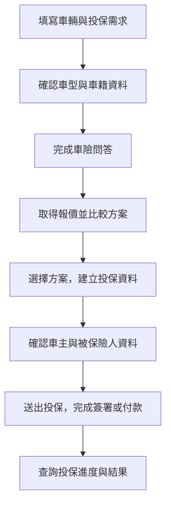
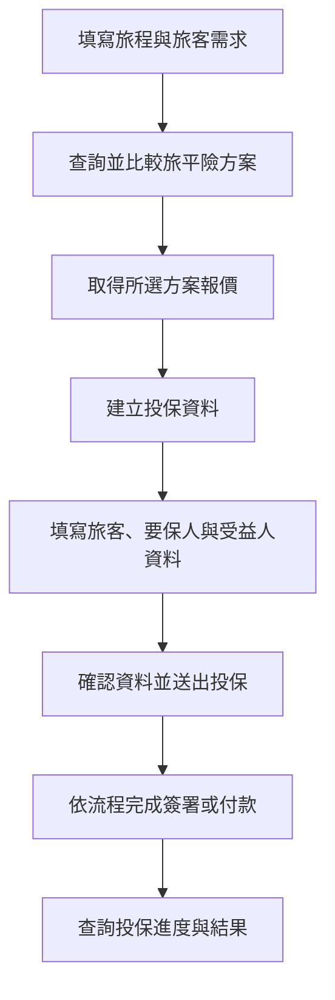

# 產險投保平台｜車險與旅平險

以車險與旅平險呈現投保流程、後端服務分層，以及平台模組如何各自承擔責任。內容以面試官易讀為主，不公開原始程式碼、承保規則或系統連線資料。

## 投保流程

### 車險

**外部保險公司介接：**報價時依所選方案向對應保險公司取得報價；投保送出後，依該公司的服務流程取得處理結果。

### 旅平險

**外部保險公司介接：**方案查詢／報價會依商品向保險公司取得資料；送件後由對應服務回傳投保處理結果。

車險先整理車輛資料與車險問答，再進入方案報價；旅平險先依旅程條件查詢、比較方案，再填寫旅客資料。兩種流程共用平台能力，但保留不同的資料準備與投保步驟。

## 後端架構

### 服務邊界

| 服務／模組 | 責任範圍 |
| --- | --- |
| **Insurance API** | 車險與旅平險的投保用例；兩種險別在此服務內分開維護 |
| **Order API** | 投保訂單與訂單查詢、管理 |
| **Member API** | 會員、客戶、被保險人及相關資料 |
| **SSO** | 身份驗證、專案與角色權限 |
| **Signature System** | 投保文件簽署與簽署狀態處理 |
| **PDF** | 保單及車輛相關文件產製 |
| **Notify** | 訊息、郵件及投保通知 |
| **Billing** | 通路與車行相關費用、佣金設定 |
| **保險公司介接層** | 封裝不同保險公司的報價、送件及結果處理 |

各後端服務有獨立建置設定，多數具有 Dockerfile，可分開建置與部署。車險與旅平險則是 Insurance API 內的業務模組，不是各自獨立的微服務。

### Insurance API 內部分層

| 層次 | 職責 |
| --- | --- |
| Controller | 按險種接收投保操作，回傳處理結果 |
| Service | 編排車險或旅平險各自的用例步驟 |
| Worker／WebService | 封裝保險公司或平台服務的通訊與轉換 |
| Mapper／Repository | 按用例讀寫所需資料 |
| DTO／Response | 定義請求與回應的資料邊界 |

採用此分工，讓險種流程保有差異，外部保險公司的介接細節留在整合層；平台服務則按會員、訂單、簽署、文件與通知等責任分開維護。

## 資料庫變更

資料庫結構以 Flyway 版本化 SQL 管理，檔名採 `V版本號__變更描述.sql`。遷移內容涵蓋新增資料表、調整既有結構與必要資料更新；CI 透過 `migrate` 套用新版本。版本檔以新增方式追蹤變更，讓資料庫演進可稽核並能配合部署重現。

## 技術

- **後端：** Java 11、Spring Boot 2.7.8、Spring Web
- **身份與 API：** Spring Security、JWT、Bean Validation、Swagger/OpenAPI
- **資料：** PostgreSQL、JPA、JDBC、MyBatis、Flyway
- **整合與部署：** REST／WebService、Maven、Docker
