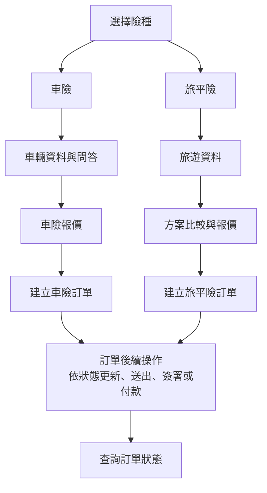

# 產險後端 API：車險與旅平險

依實際程式整理車險與旅平險 API 的投保流程與後端分層；不公開承保、計價等業務規則。

## 投保流程

圖中步驟對應程式提供的 API 能力；各操作是獨立端點，實際順序依險種與訂單狀態而定。

## 後端請求與分層

`HTTP Request → Security Filter → Controller → BaseService.request() → processData() → generateResult() → ResponseDto`

- Controller 接收 DIO 與已驗證的使用者資訊。
- 用例 Service 繼承 `BaseService`；`processData()` 依端點協調 Worker，部分用例直接使用 Mapper 或 Repository。
- `generateResult()` 組裝共用回應；輸入與輸出分別使用 DIO、DTO。

車險入口是 `CarInsuranceController`，旅平險入口是 `TravelController`。類別名稱作為程式碼對照，流程圖只呈現面試官需要理解的步驟。

## 技術堆疊

| 分類 | 技術 |
|---|---|
| 語言與框架 | Java 11、Spring Boot 2.7.8、Spring Web |
| API 與驗證 | Spring Security、JWT、Bean Validation、Swagger/OpenAPI |
| 資料存取 | PostgreSQL、Spring Data JPA、JDBC、MyBatis |
| 背景與整合 | Spring Batch、排程、WebService、Google Cloud Storage |
| 監控與建置 | Spring Boot Actuator、Maven |

English: A code-based overview of car and travel insurance API flows, layers, and technologies.
