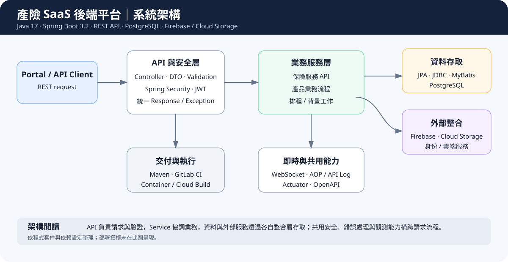
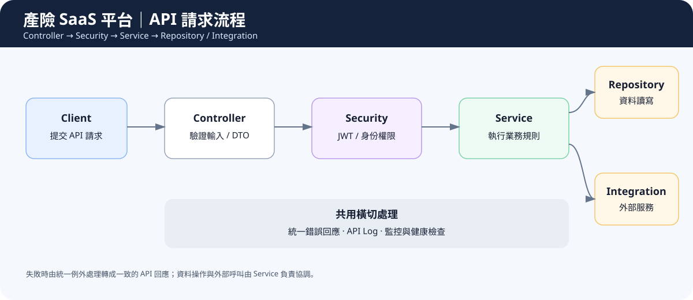

# 產險 SaaS 後端平台

**技術：** Java 17、Spring Boot 3.2.5、PostgreSQL、JPA/JDBC、MyBatis、Spring Security。

## 專案目的

提供產險 API 後端，涵蓋請求驗證、應用服務、資料存取與外部服務整合。負責車險與旅平險 API 開發。

## 架構分層

- **Controller / DTO**：API 入口、輸入驗證與資料契約。
- **Service**：應用流程協調。
- **DAO / Repository / Entity**：資料查詢與持久化。
- **Worker**：Auth、SSO 與雲端服務整合。
- **Security Filter、Base / AOP**：身份驗證、共用錯誤、回應與日誌處理。

## API 流程

[技術與架構細節](docs/architecture.md) · [請求流程說明](docs/workflow.md)

## 後續優化方向（設計建議）

- 依領域界定 JPA、JDBC 與 MyBatis 的使用邊界，避免同一資料流程分散在多種存取方式。
- 為外部 Worker 建立契約測試與標準錯誤映射，並以追蹤 ID 串起 API、資料存取和外部呼叫。

English: A Java/Spring insurance backend with layered APIs, persistence, security, and external integrations.
