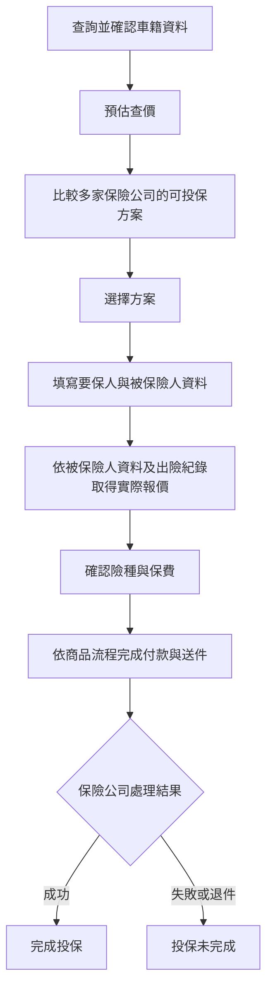
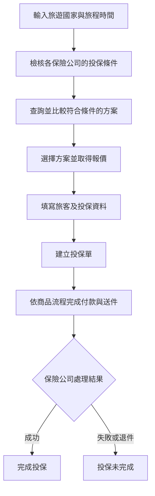
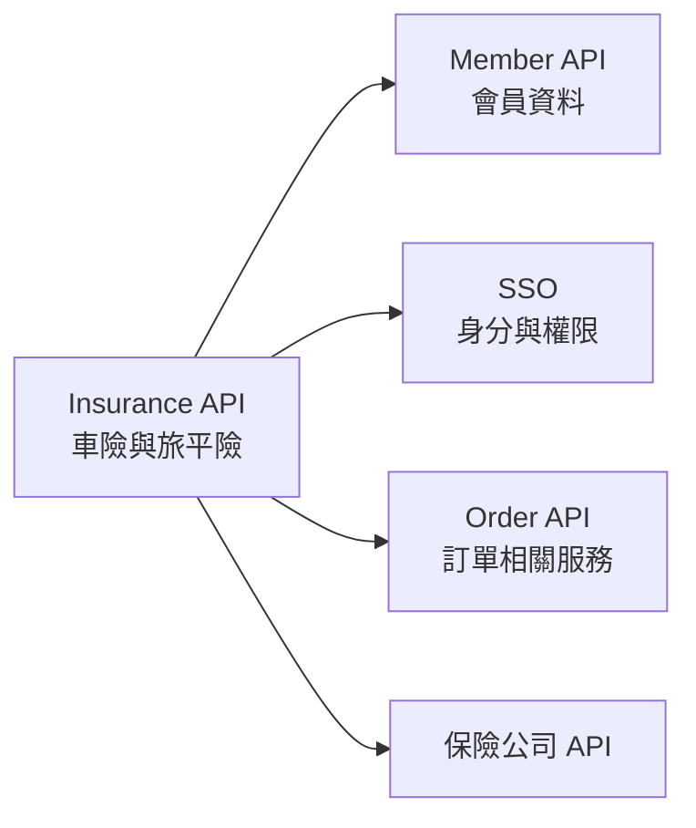

# 產險投保平台｜車險與旅平險

整合多家保險公司的商品與投保作業，支援車險及旅平險從方案查詢、報價到投保的流程。

## 個人職責

從零參與系統分析、設計與開發；分析各保險公司 API 規格，完成查價、報價、建單、送件、簽署及付款相關整合。依需求開發與修改會員、訂單、SSO 等模組，包括擴充要保人資料及企業租戶資料。

## 投保流程

### 車險

- **預估查價：**尚未填寫要保人資料時，依車籍及查價條件取得符合資格的方案。
- **實際報價：**選定方案並補齊資料後，依被保險人及出險等資料重新取得實際價格。
- **線上投保：**要保人與被保險人相同，由客戶進行線上投保。

預估查價、實際報價及投保送件依方案串接對應保險公司；實際流程與簽署、付款方式依商品及保險公司而異。

### 旅平險

旅平險依旅遊國家、旅程時間及商品條件進行檢核，並依方案介接對應保險公司。

### 訂單狀態與例外處理

車險與旅平險使用訂單狀態記錄處理進度。下表是程式中的狀態範例；實際經過的狀態依保險公司及投保路徑而異。

| 階段 | 狀態範例 | 用途 |
| --- | --- | --- |
| 建立 | 暫存 | 建立投保資料 |
| 付款 | 待付款、已付款 | 記錄付款進度 |
| 送件 | 已送交保險公司 | 記錄送件進度 |
| 結果 | 完成、取消 | 記錄訂單處理結果 |
| 異常 | 付款失敗 | 記錄付款處理結果 |

車險付款處理可記錄付款失敗；旅平險送件發生例外時會回傳錯誤資訊。車險送件也會檢查訂單是否已送交或完成，避免重複送件。各保險公司的錯誤處理與狀態轉換依實際介接流程而異。

### 投保條件檢核

車險與旅平險皆依險種及保險公司的規則檢核投保資料。平台在適用的流程中先篩除不符合條件的請求或方案，減少不必要的保險公司 API 呼叫；實際檢核項目與時機依商品及流程而異。

## 系統架構

圖中呈現 Insurance API 在不同用例中對其他服務的呼叫，並非每次請求都會經過所有服務。Cloudflare 作為外部入口；Insurance、Member、Order、SSO 等服務與 GitLab 部署於 GCP VM；GitLab CI/CD 負責建置與部署。初期集中部署以控制成本；服務按責任拆分，多數具獨立建置設定與 Dockerfile，為後續調整部署方式保留空間。

### 服務職責

| 服務 | 主要責任 |
| --- | --- |
| Insurance | 車險與旅平險投保用例 |
| Member | 會員與相關資料 |
| Order | 投保訂單 |
| SSO | 身分驗證與權限 |
| 其他服務 | 簽署、文件與通知 |

### 程式分層

| 層級 | 主要責任 |
| --- | --- |
| Controller | 接收操作並回傳結果 |
| Service | 編排投保用例 |
| Worker／WebService | 處理用例所需的整合與資料轉換 |
| Mapper／Repository | 存取資料 |
| DTO | 定義請求與回應的資料邊界 |

### 技術

- **後端與 API：**Java、Spring Boot
- **資料與遷移：**PostgreSQL、JPA、JDBC、MyBatis、Flyway
- **建置與部署：**Docker、GitLab CI/CD

資料庫結構變更透過 Flyway 版本化管理。

## 設計考量

依不同保險公司的規格處理資料轉換與外部回應，讓險種流程能與各家服務銜接；新增租戶及會員資料時，配合服務職責調整相關資料結構與 API。

## 分層說明

[查看報價流程的程式分層](architecture-demo.md)
