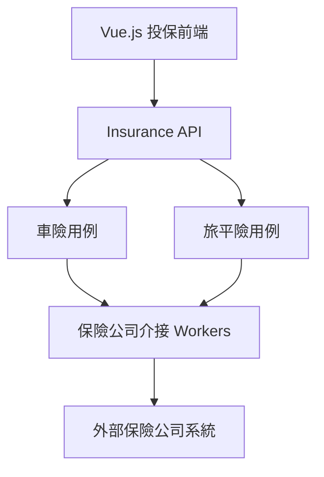
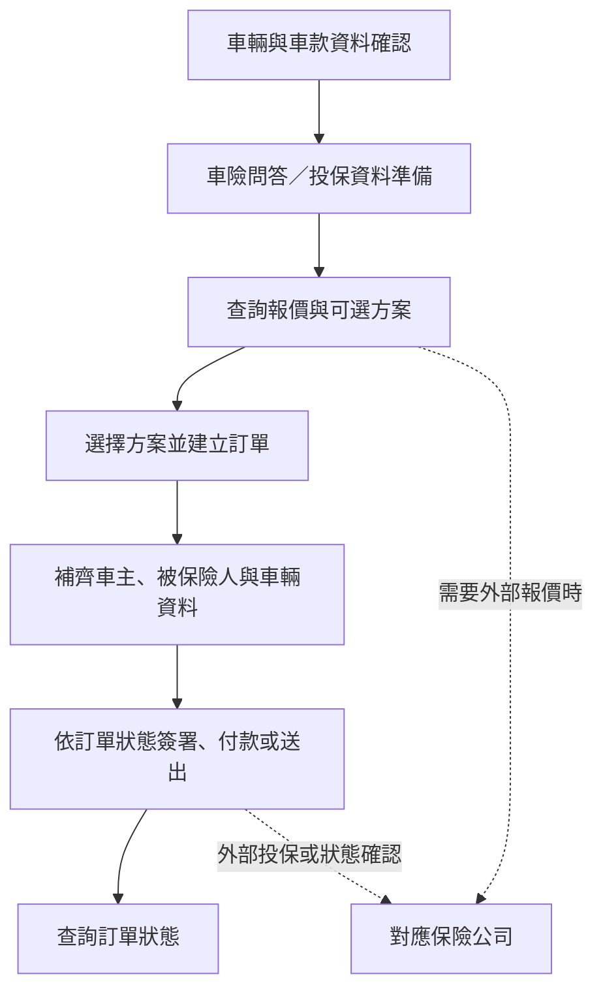
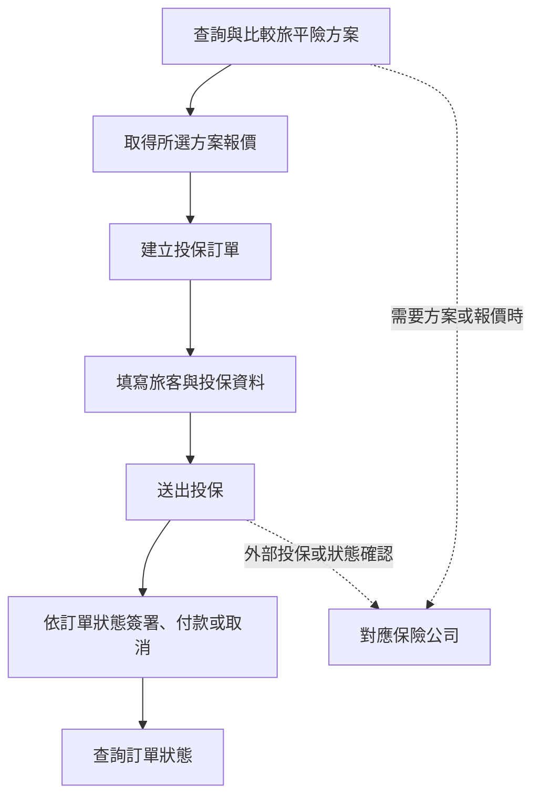

# 產險投保服務｜車險與旅平險

以車險與旅平險說明投保服務如何拆分險種流程、協作平台微服務，並介接外部保險公司。本文著重架構、服務責任與資料庫變更方式，不公開原始業務程式碼、承保規則或連線資訊。

## 整體架構

車險與旅平險屬於 `Insurance API` 內不同的業務模組，不是兩個獨立微服務。平台另有各自建置的 `order-api`、`member-api`、`sso`、`signature-system`、`pdf`、`notify` 等服務。程式中可看到 API Worker 在相關 Service 被使用，形成下表的跨服務呼叫；每個用例只呼叫自己需要的服務，不會固定跑過所有模組。

## 服務如何協作

| 服務 | 在整體流程中的責任 | 程式中可見的協作方向 |
| --- | --- | --- |
| **Insurance API** | 車險、旅平險的 API 入口與投保用例編排 | SSO、會員、訂單、簽章、PDF、通知、保險公司介接 |
| **Order API** | 車險／旅平險訂單與訂單查詢、管理流程 | Insurance、Member、Billing、Signature、Notify、SSO |
| **Member API** | 會員、客戶、被保險人及相關資料服務 | SSO、Notify；部分保單文件流程會使用 PDF 服務 |
| **SSO** | 身份驗證、專案與角色權限 | Member、Notify |
| **Signature System** | 車險／旅平險簽署與簽署文件處理 | Insurance、Member、Notify、文件工具服務 |
| **PDF** | 保單及車輛相關文件產製 | Insurance、車籍資料服務、Notify、SSO |
| **Notify** | 訊息、郵件及車險／旅平險通知 | SSO 及通知傳送通道 |
| **Billing** | 通路／車行相關費用與佣金設定 | Order API |

服務模組各有 Maven 建置設定，多數具有獨立 Dockerfile，代表可分開建置與部署的邊界。上表的協作方向依服務程式中實際使用的 API Worker 整理；箭頭代表存在呼叫能力，不表示每次投保都會依表格順序呼叫全部服務。

## 車險流程

## 旅平險流程

車險先處理車輛與車險問答；旅平險先查詢、比較方案，再建立旅客資料。兩者共用平台服務，但各自保留報價、資料準備及送件步驟。保險公司介接由對應 Worker 封裝，實際呼叫對象依選擇的方案與操作決定。

後端提供不同的 API 入口：車險有 `carAp` 與 `carAp/application`；旅平險有 `travelAp` 與 `travelAp/insureApi`。這些入口有不同用途，流程圖呈現的是險種用例摘要，不把它們合併成單一固定呼叫鏈。

## 後端分層

| 層次 | 職責 |
| --- | --- |
| Controller | 依險種與應用入口接收請求、回傳結果 |
| Service | 編排車險或旅平險用例，選擇所需協作者 |
| Worker／WebService | 隔離保險公司及平台微服務的通訊方式 |
| Mapper／Repository | 依用例存取或轉換資料 |
| DTO／ResponseDto | 定義 API 請求與回應邊界 |

`BaseService` 收斂部分共用請求生命週期；具體 Service 依流程協作不同 Worker、Mapper 或 Repository，因此實際執行路徑會因險種與操作而異。

## 資料庫變更

資料庫結構以 Flyway 版本化 SQL 管理，檔名採 `V版本號__變更描述.sql`。遷移內容包含新增資料表、調整既有結構，以及必要的資料更新；CI 流程會執行 Flyway `migrate` 套用尚未執行的版本。版本檔採序列追加，既有 migration 不直接改寫，讓資料庫變更可追蹤、可在部署流程中重現。

## 技術

- **前端：** Vue.js
- **後端：** Java 11、Spring Boot 2.7.8、Spring Web
- **身份與 API：** Spring Security、JWT、Bean Validation、Swagger/OpenAPI
- **資料與持久層：** PostgreSQL、JPA、JDBC、MyBatis、Flyway
- **跨系統整合：** REST／WebService、Maven、Docker

## 架構設計重點

- **拆分部署邊界與業務流程：**平台服務按責任分開建置；車險與旅平險在 Insurance API 內保持各自用例。
- **由用例選擇協作者：**投保服務按操作需要呼叫會員、訂單、簽章、文件或通知服務，避免將所有責任集中在單一模組。
- **隔離外部保險公司差異：**各公司通訊由專屬介接元件處理，讓險種流程不直接承擔各家協定細節。
- **資料庫變更可追蹤：**Flyway 版本檔與 CI migration 流程讓 schema 變更有序且可重現。
