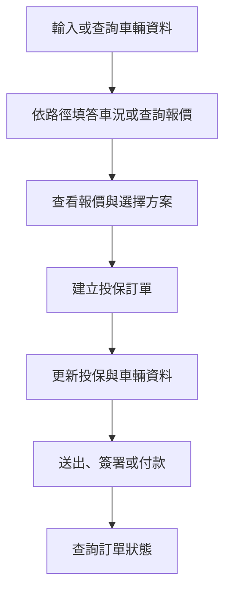
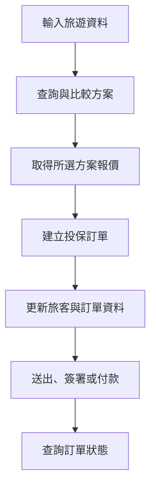
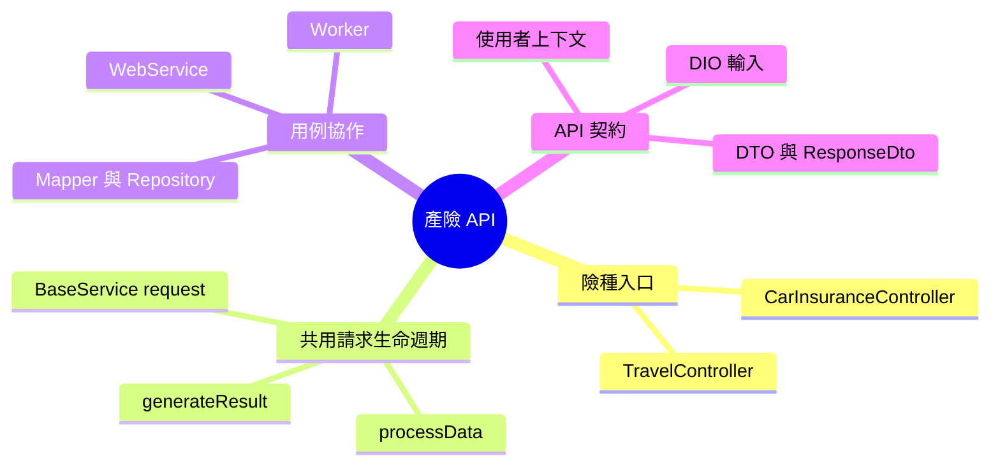

# 產險後端 API：車險與旅平險

整理車險與旅平險從資料準備、報價到訂單操作的後端 API，說明兩種險種如何共用平台能力並保留各自流程；不公開承保或計價規則。

## 投保流程

### 車險

### 旅平險

操作順序依 Controller 提供的 API 能力整理；實際端點會依險種與訂單狀態選用。ZIP 未包含前端頁面，因此圖中不呈現 UI 元件或畫面路徑。

## 架構心智圖

## 後端請求如何處理

1. Spring Security Filter 驗證請求；Controller 取得已驗證的使用者資訊。
2. 車險或旅平險 Controller 接收 DIO，交給對應用例 Service。
3. Service 繼承 `BaseService`；共用 `request()` 呼叫 `processData()` 並處理共通例外流程。
4. `processData()` 依端點使用 Worker；部分 Service 直接使用 Mapper 或 Repository。
5. `generateResult()` 將結果包裝成 DTO／`ResponseDto`。

## 設計考量

- **按險種分入口：** `CarInsuranceController` 與 `TravelController` 各自承接端點，讓不同輸入與用例依賴留在各自範圍。
- **共用穩定步驟：** `BaseService` 收斂請求生命週期；具體 Service 保留各自的資料處理與回應組裝。
- **協作者依用例選用：** Worker、Mapper、Repository 並非固定串接。這保留了用例彈性，但各 Service 的資料存取邊界並非完全一致。

## 技術

- **語言與框架：** Java 11、Spring Boot 2.7.8、Spring Web
- **API 與驗證：** Spring Security、JWT、Bean Validation、Swagger/OpenAPI
- **資料與整合：** PostgreSQL、JPA、JDBC、MyBatis、Spring Batch、WebService、Google Cloud Storage
- **維運：** 排程、Spring Boot Actuator、Maven
