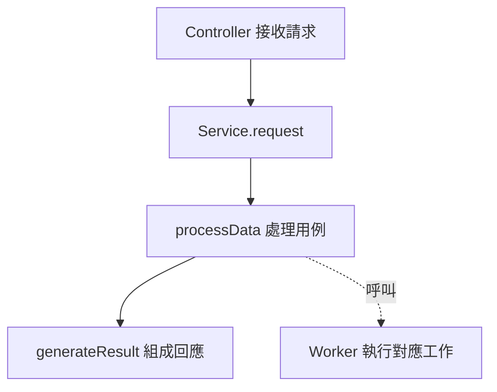

# 產險 API｜實際程式分層

車險與旅平險的報價用例，透過共用服務流程處理請求與回應。

## 請求處理

- 車險與旅平險 Controller 按操作呼叫對應 Service 的 `request`，傳入使用者與輸入資料。
- 車險及旅平險的報價 Service 繼承 `BaseService`，分別實作 `processData` 和 `generateResult`。
- 共用 `request` 在處理流程中呼叫這兩個方法，並處理例外及回應。
- 車險與旅平險的報價 Service 呼叫各自的 Worker，處理各用例所需的工作。
- `Dio` 作為這些 Service 的輸入型別，`Dto` 作為處理結果，`ResponseDto` 包裝回應。

處理過程如發生例外，會依錯誤類型處理或拋出，未必進入結果組裝；不同用例依需要使用 Worker、Mapper、Repository 或外部服務。
