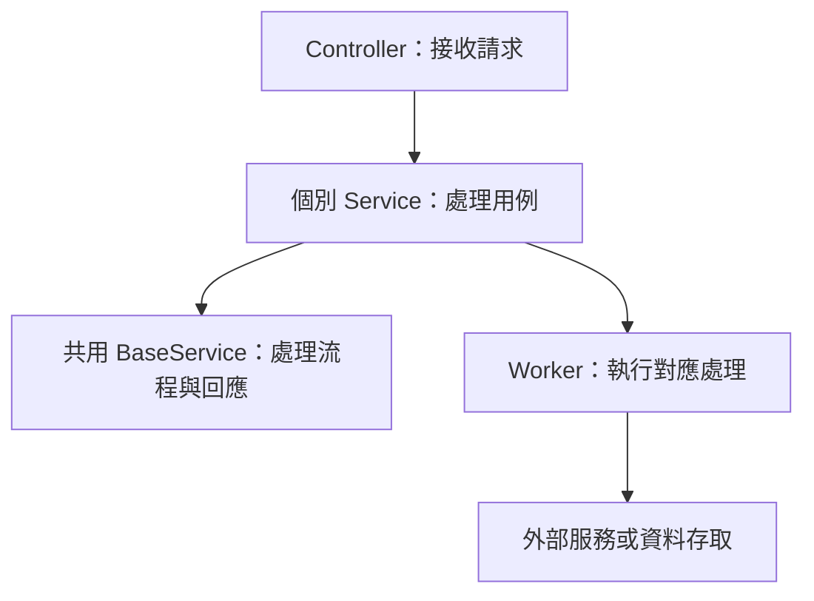

# 產險 API｜實際程式分層

以下依 Insurance 模組的車險與旅平險程式整理，名稱簡化以保護專案資訊。這是架構說明，並非可執行範例。



## 程式中確認到的關係

- 車險與旅平險 Controller 按操作呼叫對應 Service 的 `request`，傳入使用者與輸入資料。
- 受檢查的車險報價及旅平險報價 Service 繼承 `BaseService`，分別實作 `processData` 和 `generateResult`。
- 共用 `request` 在處理流程中呼叫這兩個方法，並處理例外及回應。
- 受檢查的兩個報價 Service 分別呼叫各自的 Worker；Worker 的責任依用例不同，不能一概描述為外部 API 介面。
- `Dio` 作為這些 Service 的輸入型別，`Dto` 作為處理結果，`ResponseDto` 包裝回應。

```text
Controller
  └─ service.request(使用者, 輸入)
       ├─ processData(使用者, 輸入) → 對應 Worker
       └─ generateResult(使用者, 處理結果, 開始時間) → ResponseDto
```

此圖描述已檢查的報價路徑；不同用例可能使用不同 Worker、Mapper、Repository 或外部服務，不能推定所有請求都經過相同元件。
