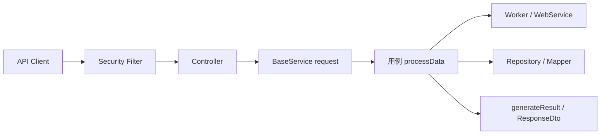

# 產險 API 模組架構

依 `insurance` Maven 模組的實際套件與類別整理。車險與旅平險的業務流程見[專項說明](https://github.com/highhao/vehicle-travel-insurance-api)。

## 技術堆疊

| 分類 | 技術 |
|---|---|
| 語言與框架 | Java 11、Spring Boot 2.7.8、Spring Web |
| API 與驗證 | Spring Security、JWT、Bean Validation、Swagger/OpenAPI |
| 資料存取 | PostgreSQL、Spring Data JPA、JDBC、MyBatis |
| 背景與整合 | Spring Batch、排程、WebService、Google Cloud Storage |
| 監控與建置 | Spring Boot Actuator、Maven |

## 架構分工

| 層／套件 | 責任 |
|---|---|
| `controller` | API 入口、驗證輸入、取得登入者資訊 |
| `service`、`base` | 用例流程；具體 Service 繼承 `BaseService`，處理資料並組裝回應 |
| `worker`、`webservice` | 用例協作、驗證／通知，以及需要時的外部服務整合 |
| `dao` | Repository、Mapper 與資料模型 |

## 實際呼叫關係

Worker 與資料存取依用例選用；Service 不一定經過相同元件，也可能直接存取 Mapper 或 Repository。

English: A Java API module organized around controllers, use-case services, workers, integrations, and persistence.
